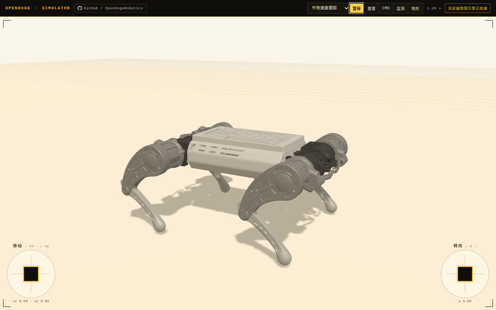
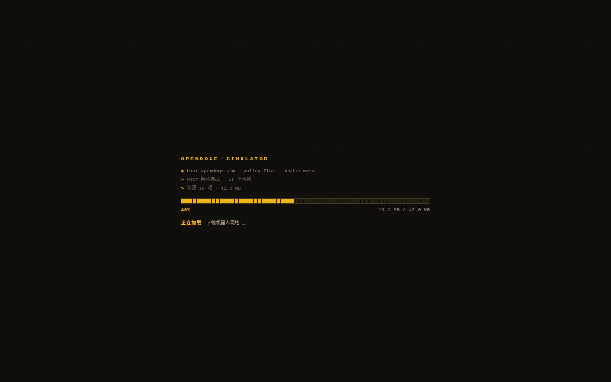
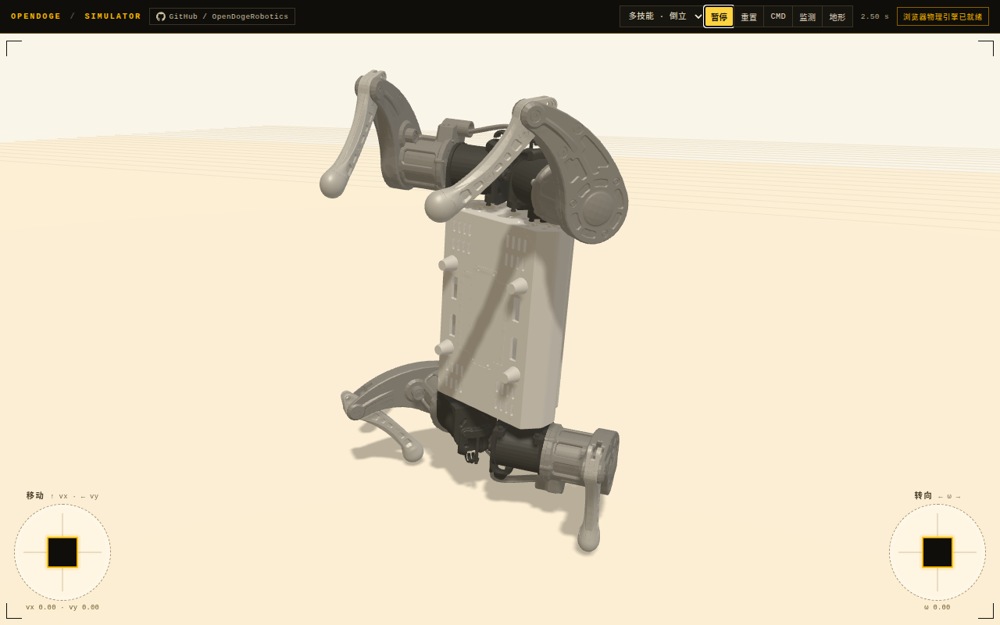
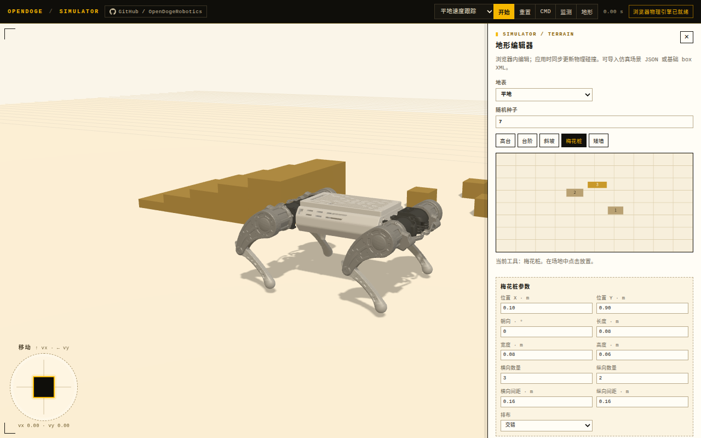

# OpenDoge 在线仿真器

浏览器内运行的 OpenDoge 策略仿真器：MuJoCo（WebAssembly）在页面里跑物理，ONNX Runtime Web 执行训练产出的策略网络。没有 Python 后端，也不依赖跨源隔离响应头，构建产物是纯静态站点，可直接挂在 GitHub Pages 上。

**在线地址**：<https://opendogerobotics.github.io/>



首屏是一个终端风格的加载页：进度条按**实际下载字节**推进（`HEAD` 预检 `content-length` 得到真实总量，再按流式读取累加），显示 `已下载 / 总量 MB`，而不是按阶段硬编码的百分比。



## 现在包含什么

| 策略 | 来源 | 观测 | 说明 |
| --- | --- | --- | --- |
| 平地速度跟踪 | `opendoge/flat` | 48 维 | 摇杆或 WASD/QE 给出 vx / vy / ω 指令 |
| 粗地形行走 | `opendoge/rough` | 213 维 | 48 维本体 + 165 维地形高度扫描 |
| 多技能 · 行走 | `opendoge/skills` | 57 维 | 同一网络的 walk 技能 |
| 多技能 · 倒立 | `opendoge/skills` | 57 维 | 同一网络的 handstand 技能，前腿倒立约 0.22 m |
| 多技能 · 起身 | `opendoge/skills` | 57 维 | 同一网络的 getup 技能，仰卧起身 |
| 跌倒起身 | `opendoge/getup` | 48 维 | 单技能起身基线 |

`opendoge/skills` 是一个网络承载 walk / handstand / getup / jump 四种技能。页面里把前三种拆成独立条目（各自带正确的起始姿态），jump 需要按训练时的起跳状态机推进相位与离地标志，暂未开放。





机器人模型来自 `OpenDoge_train/src/assets/robots/opendoge/xmls`（OpenDoge V1.1，13 个 STL 网格）。视觉网格直接由同一份 MJCF 驱动，物理与渲染不会有模型偏差。

除策略外还保留了这些交互：

- 虚拟摇杆 / 键盘控制运动指令，可调指令幅值
- 实时监测：机身位置、接触数、12 维动作曲线
- 用鼠标拖拽机身可施加冲量：箭头始终从**躯干质心**出发（不是鼠标命中的表面点），方向与距离对应推力方向与大小
- 极客风格界面：等宽字体、直角面板、1px 描边、琥珀色高亮、HUD 角标；CMD / 监测 / 地形三个面板都可以按住标题拖动
- 浏览器内地形编辑器：
  - 高台 / 矮墙 / 斜坡 / 台阶 / 梅花桩按**米制尺寸**放置，俯视图上可直接拖动标记改位置
  - 斜坡用真实楔形网格（渲染与 MuJoCo 碰撞体同形），按**斜率 %** 与长度联动高度
  - 台阶可调阶数 / 阶深 / 阶宽 / 阶高；梅花桩支持并列 / 交错 / 斜列排布与行列间距
  - 预置平地 / 坡道 / 阶梯 / 随机障碍，支持导出与导入 JSON（兼容早期版本的 scaleX/scaleY 字段）

## 本地运行

```bash
npm install
npm run dev        # 开发服务器
# 或
npm run build && npx vite preview
```

`npm run dev` / `npm run build` 会先执行 `scripts/prepare-assets.mjs`：如果同级目录存在 `OpenDoge_train`，就从训练仓库同步机器人模型与策略到 `public/`；否则直接使用仓库中已提交的资产（GitHub Actions 走的就是这条路径）。

```bash
OPENDOGE_TRAIN=/path/to/OpenDoge_train npm run prepare-assets
```

## 与训练侧保持一致的细节

页面不是"看起来像"的近似动画，观测与动作链路按 `mjlab` 训练配置复刻：

- 观测 48 维：`[机身线速度(3), 角速度(3), 投影重力(3), 关节位置(12), 关节速度(12), 上一步动作(12), 指令(3)]`，无额外缩放
- 动作 12 维：`位置目标 = 默认关节角 + 0.25 × 策略输出`
- 关节执行器：`<position>` 内置 PD，`kp=12`、`kd=0.5`、力矩上限髋/大腿 6 N·m、小腿 9 N·m，关节 `armature=0.005`
- 物理：时间步 2 ms，`decimation=2`，即策略 250 Hz
- 初始状态：机身 `z=0.158 m`，关节角与 `OPENDOGE_INIT_STATE` 一致（起身策略从仰卧 `z=0.06 m` 开始；倒立用训练重置分布内的 1.05 倍关节角）
- 粗地形策略的 165 维高度扫描按 mjlab `GridPatternCfg(size=(0.7, 0.5), resolution=0.05)` 复刻：15×11 网格、机身偏航对齐、竖直向下、命中失败记 5 m，再乘 `1/5`
- 多技能策略的尾部 9 维是 `[跳跃指令(3), one_hot(walk, handstand, getup, jump)(4), phase_sin, phase_cos]`；静止技能的相位恒为 `(0, 1)`

逐条对齐 Python 参考实现（3 秒）：

| 策略 | 浏览器 | Python |
| --- | --- | --- |
| 平地速度跟踪（0.4 m/s） | `x=1.07` | `x=1.063` |
| 粗地形行走（0.2 m/s） | `x=0.51` | `x=0.503` |
| 多技能 · 行走（0.2 m/s） | `x=0.39` | `x=0.392` |
| 多技能 · 倒立 | `z=0.22` | `z=0.219` |

## 接入新策略

`tools/reference_sim.py` 是浏览器控制回路的 Python 参考实现，可在把新策略放进 `public/policies/` 之前先验证它是否站得住、走得动：

```bash
python tools/reference_sim.py --policy public/policies/opendoge-flat.onnx --command 0.4 0 0 --duration 3
# final x=1.063 y=0.037 z=0.157

python tools/reference_sim.py --policy public/policies/opendoge-rough.onnx --command 0.2 0 0 --duration 3
python tools/reference_sim.py --policy public/policies/opendoge-skills.onnx --skill handstand --init-scale 1.05
python tools/reference_sim.py --policy public/policies/opendoge-getup.onnx --init fallen --duration 5
```

需要 `mujoco`、`numpy`、`onnxruntime`；默认从同级 `OpenDoge_train` 读取场景，可用 `--scene` 或 `OPENDOGE_TRAIN` 覆盖。验证通过后，在 `src/main.js` 的 `policies` 表里加一条（`file`、`inputSize`、`init`、`commandRanges`）即可。

## 部署

仓库自带 GitHub Actions 工作流（`.github/workflows/deploy.yml`）：推送到 `main` 后自动 `npm ci && npm run build`，并把 `dist/` 发布到 GitHub Pages。

首次使用时在仓库 **Settings → Pages → Build and deployment** 把 Source 设为 **GitHub Actions** 即可。

## 说明

- 这是面向演示的在线仿真器，不作为训练验收工具；正式评估仍应使用 `OpenDoge_train` 的 MuJoCo/Viser 流程。
- `public/robot/assets/*.STL` 约 19 MB，首次打开需要一点加载时间，之后由浏览器缓存。
- 带历史帧的旧策略（`OpenDoge_train/onnx/` 下 270 维那批）用的是另一套观测口径，没有接入。
- `opendoge/skills` 的 jump 技能需要训练时的起跳状态机（相位、离地锁存、四足离地判定），当前版本未实现。
- 机器人资产由 OpenDogeRobotics 维护；训练侧代码与策略见 [OpenDogeRobotics/OpenDoge_train](https://github.com/OpenDogeRobotics/OpenDoge_train)。
